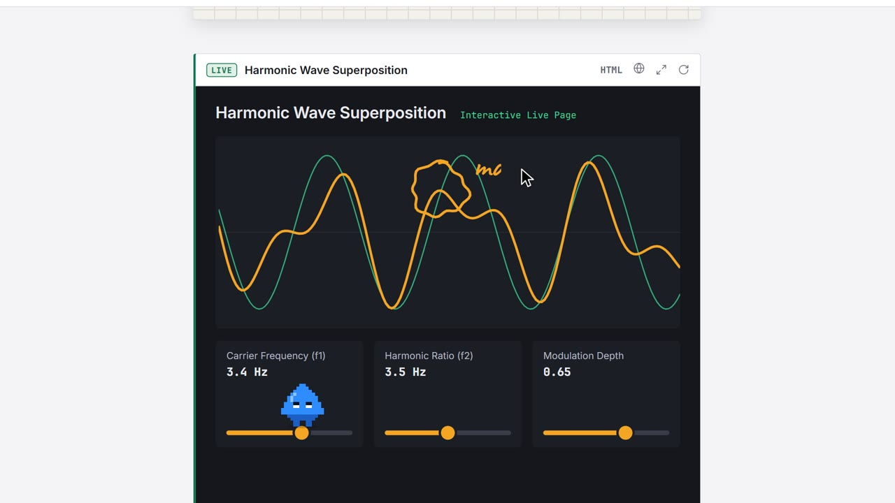
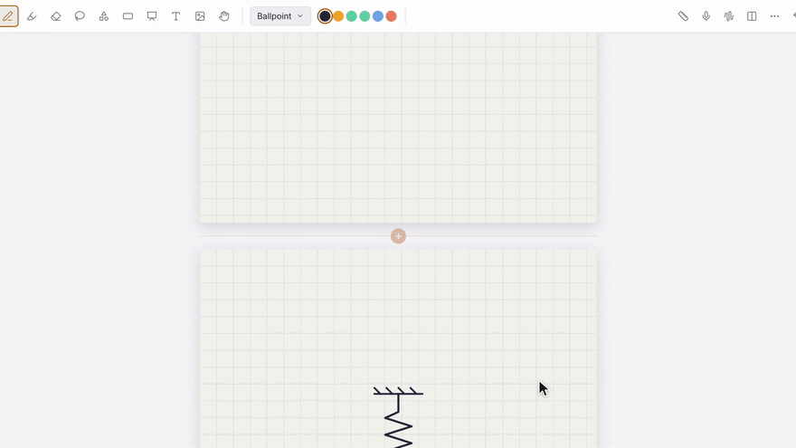
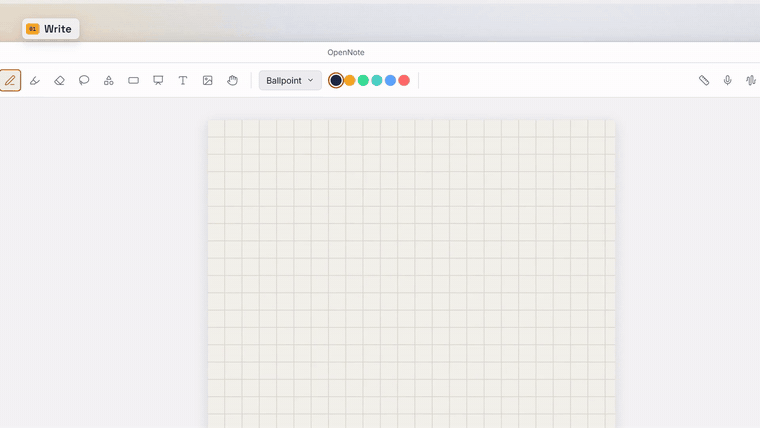
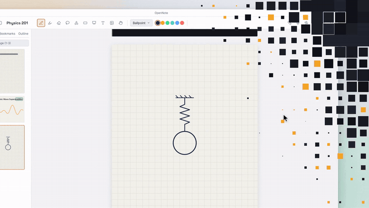
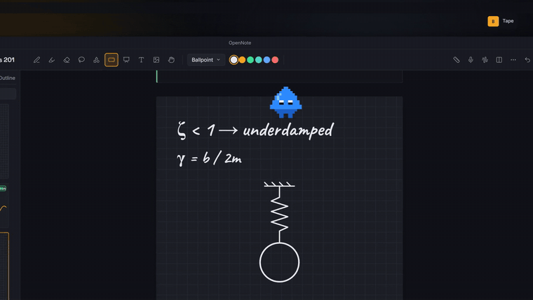
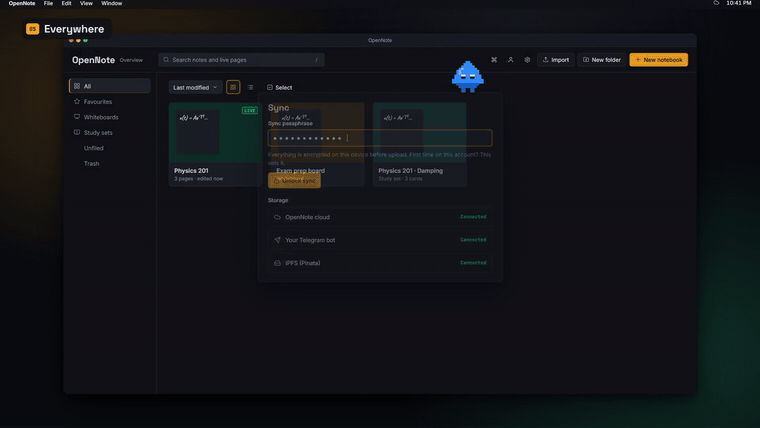

<div align="center">

<a href="https://opennote-neon-nine.vercel.app"></a>

# OpenNote

### Notes that run.

A free, pen-first notebook for lectures and problem sets.<br>
Write with your stylus, record the class, and paste an AI-made visualiser **between your pages, where it runs.**

[](https://opennote-neon-nine.vercel.app)
[](https://github.com/Archemasachika7/opennote/releases/latest/download/OpenNote-android.apk)
[](https://github.com/Archemasachika7/opennote/releases/latest/download/OpenNote-windows-setup.exe)

[](https://github.com/Archemasachika7/opennote/actions/workflows/build-apps.yml)


**[Download](#-download)** · **[Features](#-what-it-does)** · **[How live pages work](#-how-live-pages-work)** · **[Build from source](#-build-from-source)**

</div>

---

## ✨ Copy an AI artifact. Paste. It runs.

Ask Claude, ChatGPT or Gemini for an interactive visualiser, copy the code, paste it into a **Live page** and press **Save**. It runs right between your handwritten pages, offline and sandboxed, and you can still write on top of it with your pen.

<p align="center"></p>

Works with **HTML**, **SVG** and **React/JSX**. React runs from a bundled copy, so it works without internet.

---

## 🖊️ What it does

<table>
<tr>
<td width="50%" valign="top">

### Handwriting that feels like paper
Pressure-sensitive ballpoint, fountain and brush pens, a highlighter, and partial or whole-stroke erasing. Hold still for 0.4 s and a rough circle snaps into a clean shape. Lasso anything, then cut, copy and paste it to any page.

</td>
<td width="50%" valign="top">



</td>
</tr>
<tr>
<td width="50%" valign="top">



</td>
<td width="50%" valign="top">

### Lectures you can replay
Record the class while you write. Later, **tap any stroke** to hear that exact moment, or replay your ink in sync with the audio. Transcripts run **on your device** with Whisper, even offline.

</td>
</tr>
<tr>
<td width="50%" valign="top">

### Revision that remembers for you
Hide key terms under **Tape**, then turn them into flashcards in one click. Spaced repetition (FSRS-6 or SM-2) schedules each card for just before you'd forget it.

</td>
<td width="50%" valign="top">



</td>
</tr>
<tr>
<td width="50%" valign="top">



</td>
<td width="50%" valign="top">

### Everywhere, and private
The same notebook on the web, Android and Windows. Everything lives on your device first. Sign-in is optional, and sync is **end-to-end encrypted** with your passphrase before anything is uploaded.

</td>
</tr>
</table>

### Everything else in the box

| | |
|---|---|
| 📓 **Notebooks** | Ink, Text and Live pages in one binder · paper templates (blank, ruled, grid, dot) · light or dark paper · bookmarks, outline and go-to-page |
| 🧾 **Text pages** | Headings, lists, checklists, tables, colour, highlight and LaTeX-style math symbols (`\alpha` → α) |
| 📄 **PDF** | Import a PDF and write on it · export a notebook or page range to PDF or JPG |
| 🧑‍🏫 **Present** | Laser pointer with a fading trail · ruler · zoom window · split-screen notebooks |
| 🧠 **Study sets** | Flashcards from Tape or the Lasso · image occlusion · retention and stability stats |
| 🗺️ **Whiteboards** | Infinite canvas with a minimap, layers and reusable STEM stamps |
| 🎙️ **Speech** | Live dictation, on-device Whisper transcripts, and optional Sarvam AI for 11 Indian languages |
| 🗂️ **Library** | Folders, favourites, search across notes and live pages, Trash with 30-day restore |
| 💾 **Backups** | One-file `.opennote` backups you can move between devices |
| ☁️ **Sync (optional)** | Encrypted on your device, then stored in OpenNote cloud, your own Telegram bot or IPFS (Pinata) |
| ⌨️ **Keyboard** | Single-key tools (P pen, H highlighter, L lasso, S shapes, B tape…) and a Ctrl+K command palette |

---

## 📥 Download

| Platform | Get it | Notes |
|---|---|---|
| 🌐 **Web** | **[opennote-neon-nine.vercel.app](https://opennote-neon-nine.vercel.app)** | Works in Chrome or Edge. Install it as an app from the address bar. |
| 🤖 **Android** | **[OpenNote-android.apk](https://github.com/Archemasachika7/opennote/releases/latest/download/OpenNote-android.apk)** | Phones and tablets, with stylus pressure and palm rejection. |
| 🪟 **Windows** | **[OpenNote-windows-setup.exe](https://github.com/Archemasachika7/opennote/releases/latest/download/OpenNote-windows-setup.exe)** | Windows 10 and 11, laptops and pen tablets. |

All downloads are on the **[Releases page](https://github.com/Archemasachika7/opennote/releases/latest)**.

<details open>
<summary><b>🤖 Install on Android (APK)</b></summary>

1. On your phone or tablet, open the **[latest release](https://github.com/Archemasachika7/opennote/releases/latest)** and tap **`OpenNote-android.apk`**.
2. When the download finishes, tap **Open**.
3. If Android asks, allow your browser to **install unknown apps** (Settings → Apps → your browser → *Install unknown apps* → allow). OpenNote isn't on the Play Store yet, so Android asks once.
4. Tap **Install**, then **Open**.
5. If Play Protect warns that the app is from an unknown developer, tap **More details → Install anyway**.

To update, install the newer APK over the old one. Your notebooks stay.

> **Coming from v0.2.4 or earlier?** From v0.2.5 the APK is signed with a new private key (the old one had been published by mistake), so Android won't install v0.2.5 over an older version. Once:
> 1. In the old app, back up each notebook from its **⋯ menu → Export backup (.opennote)**. If you use sync, your notes are also safe in your account.
> 2. Uninstall the old app, install the new APK.
> 3. Use **Import** in the library (or sign in to sync) to bring the notebooks back.
>
> From v0.2.5 on, every APK installs over the previous one again.

</details>

<details open>
<summary><b>🪟 Install on Windows (EXE)</b></summary>

1. Download **`OpenNote-windows-setup.exe`** from the **[latest release](https://github.com/Archemasachika7/opennote/releases/latest)**.
2. Double-click it.
3. The installer isn't code-signed yet, so Windows SmartScreen may say *"Windows protected your PC"*. Click **More info → Run anyway**.
4. Follow the installer. OpenNote appears in the Start menu.

OpenNote uses Microsoft Edge WebView2, which Windows 10 and 11 already include. To uninstall, use **Settings → Apps**.

</details>

<details>
<summary><b>🧪 Get the newest build before a release</b></summary>

Every push to `master` builds both apps.

1. Open **[Actions → Build apps](https://github.com/Archemasachika7/opennote/actions/workflows/build-apps.yml)** and click the newest green run.
2. Scroll to **Artifacts** and download **OpenNote-android** or **OpenNote-windows** (you need to be signed in to GitHub).
3. Unzip it, then install as above.

</details>

---

## 🧩 How live pages work

```
 copy from your AI chat ──► paste into "New live page" ──► Save ──► it runs between your pages
                                     │
                     detects HTML · SVG · React/JSX
```

- Each live page runs in a **sandboxed iframe** with its own origin and a strict Content-Security-Policy. It can't read your notebooks, your files or the app.
- **No internet by default.** Turn on *Allow internet for this page* only when the artifact needs a CDN library. Live pages imported from a backup always start with internet off.
- React artifacts are compiled inside the sandbox with a bundled Babel and React, so they work offline.
- Switch between **Use page** (click and drag the visualiser) and **Write on page** (annotate it). A stylus always writes.

---

## 🛠️ Build from source

You need **Node 20+**.

```bash
git clone https://github.com/Archemasachika7/opennote.git
cd opennote
npm install
npm run dev
```

Then open http://localhost:5173.

| Command | What it does |
|---|---|
| `npm run dev` | Start the web app with hot reload |
| `npm run build` | Type-check and build the web app into `dist/` |
| `npm test` | Unit tests (Vitest) |
| `npm run e2e` | End-to-end tests in Chrome (Playwright) |

The Android (Capacitor) and Windows (Tauri) apps are built by [GitHub Actions](.github/workflows/build-apps.yml). Push a tag like `v0.2.0` to publish both on a Release.

<details>
<summary><b>Tech stack</b></summary>

| Layer | Choice |
|---|---|
| App | React 18 + TypeScript + Vite |
| Ink | perfect-freehand on Canvas 2D, Pointer Events with pressure and palm rejection |
| Text | TipTap (ProseMirror) |
| Storage | Dexie (IndexedDB), local-first |
| PDF | pdf.js (import) and pdf-lib (export) |
| Transcription | Whisper via transformers.js, on device |
| Sync | WebCrypto AES-GCM, Supabase, Telegram bot or IPFS (Pinata) |
| Android | Capacitor 8 |
| Windows | Tauri 2 (NSIS installer) |

</details>

---

## 🤝 Contributing

The full story of the project (timeline, every feature, screen layouts, architecture) is in **[docs/OPENNOTE_PROJECT.md](docs/OPENNOTE_PROJECT.md)**.

Bug reports and ideas are welcome. **[Open an issue](https://github.com/Archemasachika7/opennote/issues/new)** with what you did, what you expected and a screenshot. Pull requests should keep `npm test` and `npm run build` green.

<div align="center">

### If OpenNote saves you a notebook, give it a ⭐

It helps other students find it. **[⭐ Star OpenNote](https://github.com/Archemasachika7/opennote)**

<sub>Free · No ads · No account needed · Made for students who think with a pen</sub>

</div>
